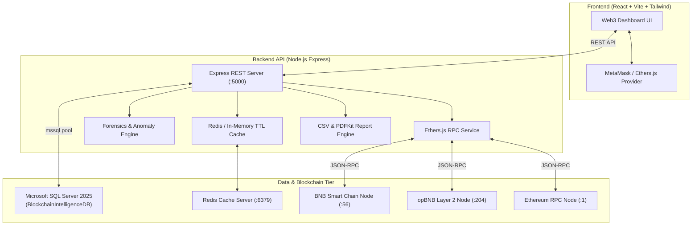

# 🛡️ ChainIntel — Blockchain Portfolio & Transaction Intelligence

An enterprise-grade Web3 dashboard for real-time tracking of crypto wallets, multi-chain balances, transaction forensics, gas optimization, and automated threat anomaly detection across **BNB Smart Chain (BSC)**, **opBNB**, and **Ethereum**.

Built with **React**, **Node.js**, **Ethers.js v6**, **Microsoft SQL Server 2025**, and **Redis** caching architecture.

---

## 🚀 Key Features

### 1. 🦊 Seamless Web3 & MetaMask Integration
- **Connect MetaMask**: One-click wallet authorization with real-time account change and network switch listeners.
- **Network Switching**: Instantly switch between **BSC Mainnet (ChainId 56)**, **opBNB Mainnet (ChainId 204)**, and **Ethereum (ChainId 1)**, with automatic network provisioning via `wallet_addEthereumChain`.
- **Target Wallet Explorer**: Track any external EVM address or toggle between built-in Demo Whales (Hot Vaults & Arbitrageurs) without requiring an installed wallet.

### 2. ⚡ Multi-Chain RPC Telemetry (BSC & opBNB)
- Live RPC block height monitoring, latency ping measurement, and current base fee tracking in Gwei.
- High-efficiency opBNB Layer 2 tracking showcasing sub-cent gas fee execution (saving up to 99.8% vs L1).

### 3. 💰 Real-Time Token Balances & Portfolio Valuation
- Live balances for native assets (**BNB**, **ETH**) and ERC-20 standard tokens (**USDT**, **USDC**, **CAKE**, **BTCB**).
- Real-time USD valuation with 24h price changes, interactive asset allocation donut distribution, and on-chain RPC state sync.

### 4. 🔍 Transaction Intelligence & Forensic Anomaly Radar
- **Failed / Reverted Transaction Detection**: Decodes revert reasons (e.g. `INSUFFICIENT_OUTPUT_AMOUNT`, `OUT_OF_GAS`), identifying lost gas capital.
- **Gas Spike Detector**: Identifies transactions that paid `> 3x` the network baseline, highlighting overpayment anomalies.
- **Unlimited Approval Scanner**: Discovers infinite ERC-20 token allowances (`2^256 - 1`) granted to spender contracts with direct remediation links to **Revoke.cash**.
- **Wallet Health & Safety Score**: Computes a dynamic 0–100 security rating based on execution failure rates, approval exposure, and gas efficiency.

### 5. 🔔 Custom Alerts & Automated Notification Feed
- Configure custom rule conditions:
  - Transaction failures on specific chains
  - Gas price exceeding customized Gwei threshold
  - High-value outflow transfers (`> $10,000`)
  - Critical contract interactions
- In-dashboard notification drawer with unread counter badges and one-click dismissal.

### 6. 📄 Auditor-Grade Downloadable Reports
- **CSV Ledger**: Tax and accounting-ready spreadsheet containing transaction hashes, blocks, UTC timestamps, counterparties, gas expenses, and anomaly flags.
- **PDF Intelligence Audit Report**: Multi-page executive summary formatted with portfolio valuation, security health gauge, threat radar items, and ledger excerpts.
- **JSON Bundle**: Machine-readable forensics dump for automated CI/CD and compliance pipelines.

---

## 🏗️ System Architecture



---

## 🗄️ SQL Server Database Schema

The solution runs on Microsoft SQL Server with relational integrity and optimized indexing:

- **`Networks`**: Supported chains, RPC URLs, explorers, chain IDs, and testnet flags.
- **`Wallets`**: Monitored addresses, ENS handles, labels, safety scores, and net worth summaries.
- **`TokenBalances`**: Native and ERC-20 balances, decimals, raw balances, USD prices, and logos.
- **`Transactions`**: Full transaction ledger enriched with gas used, gas price (Gwei), USD fee, status, error code, revert reasons, method names, and risk scores.
- **`TransactionAnomalies`**: Security audit flags (`FAILED_TX`, `GAS_SPIKE`, `UNLIMITED_APPROVAL`, `LARGE_OUTFLOW`), severity levels, and remediation advisories.
- **`AlertRules`**: User-defined condition thresholds and notification triggers.
- **`AlertNotifications`**: Generated event records and unread statuses.
- **`AuditReports`**: Stored snapshots of generated PDF/CSV audit reports.
- **`vw_PortfolioSummary`**: Real-time aggregated view of portfolio metrics and gas burn.

---

## 🛠️ Tech Stack

| Component | Technology | Rationale |
| :--- | :--- | :--- |
| **Frontend** | React 19, Vite, Tailwind CSS, Lucide Icons | High-performance Web3 dark aesthetic with sub-second HMR |
| **Web3 Client** | Ethers.js v6 | Native RPC provider connectivity, contract calls & MetaMask interaction |
| **Backend** | Node.js, Express, mssql, ioredis, pdfkit | Scalable REST API with connection pooling & PDF streaming |
| **Database** | Microsoft SQL Server 2025 | Relational persistence, transactional integrity, and analytical views |
| **Cache Layer** | Redis + In-Memory Fallback Engine | Sub-millisecond latency for token price and RPC state caching |
| **Blockchain** | BSC Mainnet, opBNB Mainnet, Ethereum | Multi-chain support focusing on BNB Chain ecosystem and L2 scaling |

---

## ⚡ Quick Start Guide

### Prerequisites
- Node.js (v18+)
- Microsoft SQL Server (2019/2022/2025) running locally on port 1433
- Redis (optional, high-performance in-memory fallback enabled automatically if offline)
- MetaMask browser extension (optional for live wallet interaction)

### 1. Database Setup
Execute the initialization script to create `BlockchainIntelligenceDB` and populate seed data:
```powershell
.\init-db.ps1
```
*(Or run `database/schema.sql` and `database/seed.sql` in SQL Server Management Studio / sqlcmd)*

### 2. Start the Backend API
```powershell
cd backend
npm install
node server.js
```
The server will start on `http://localhost:5000`. Test health at `http://localhost:5000/api/health`.

### 3. Start the Frontend
In a separate terminal:
```powershell
cd frontend
npm install
npm run dev
```
Open **`http://localhost:3000`** in your browser.

---

## 💼 Career & Portfolio Highlights

This project demonstrates comprehensive mastery required for senior Web3 and blockchain engineering roles:
1. **Full-Stack Blockchain Integration**: Querying native RPCs, decoding ERC-20 contract storage, and managing EIP-1193 wallet interactions.
2. **Security & Forensic Intelligence**: Detecting reentrancy/slippage reverts, gas overpayments, and infinite approval phishing vectors.
3. **Enterprise Data Architecture**: Structuring relational SQL Server schemas, views, and connection pooling alongside low-latency Redis caching.
4. **Professional Product Polish**: Production-grade dark UI, dynamic reports (CSV/PDF), and responsive multi-chain telemetry.
